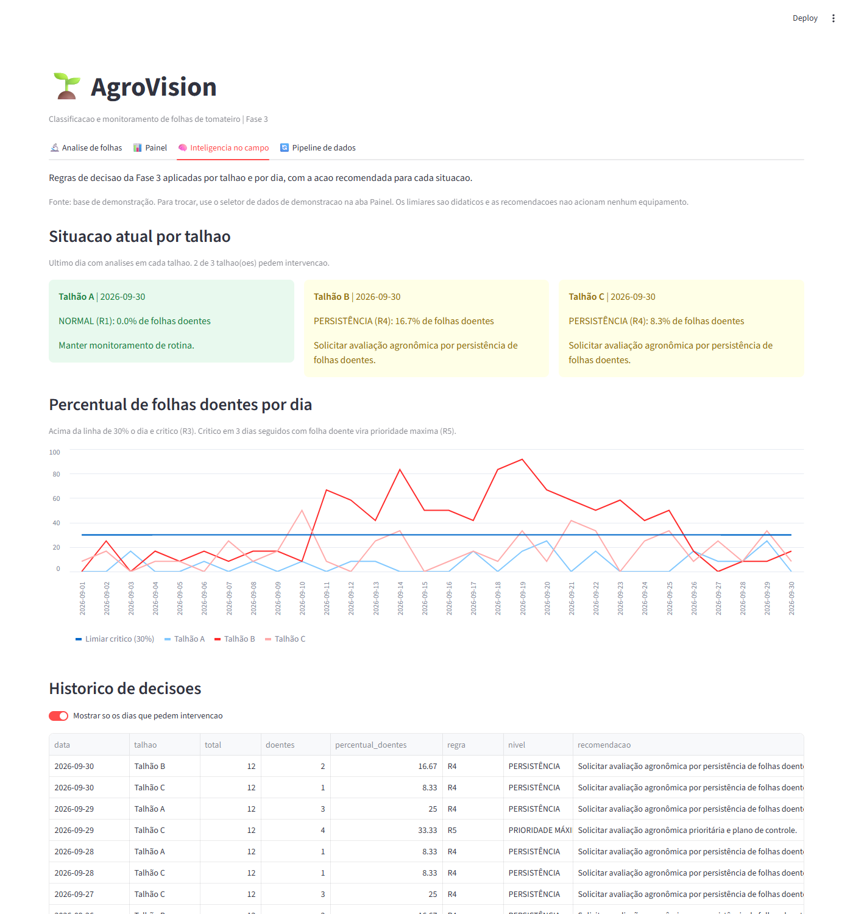
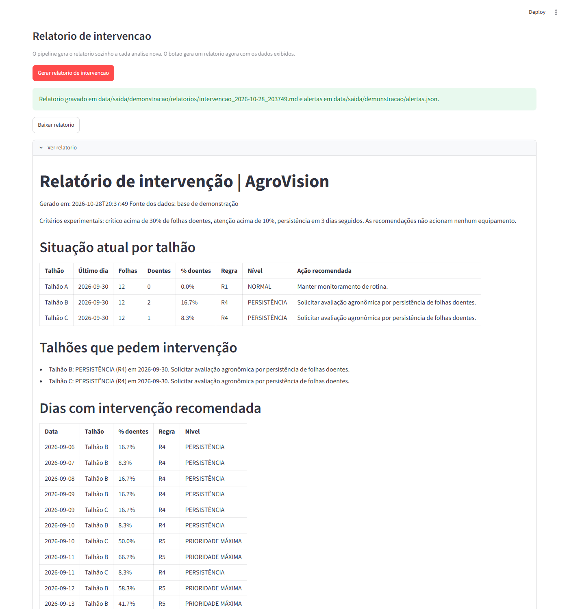
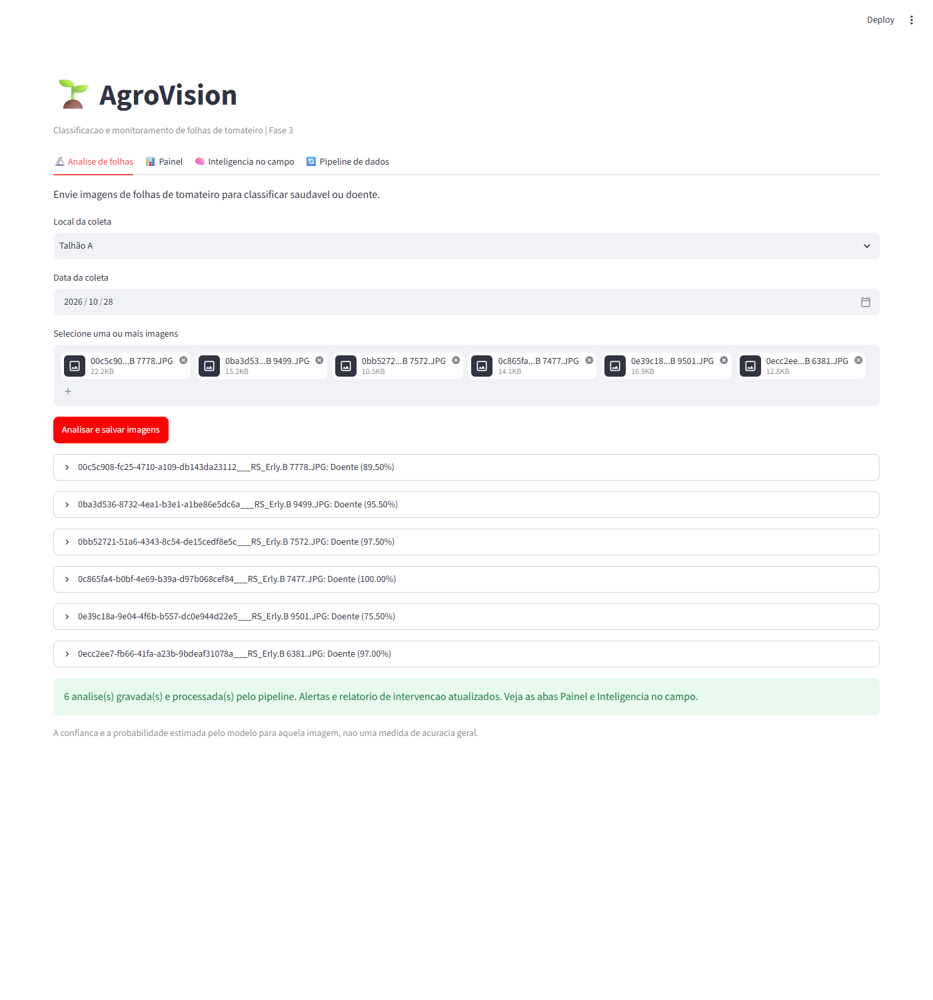
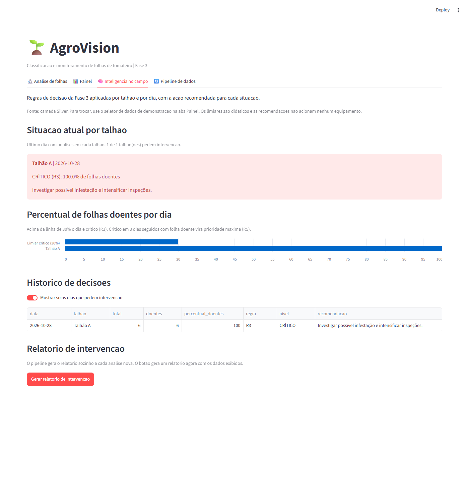

# Fase 3 | Automação das ações

Este documento descreve o passo 2 da Fase 3: a resposta automática do sistema
às regras de decisão. As regras (passo 1) estão em
[Fase3_Logica_Decisao/Regras_e_Fluxograma.pdf](../Fase3_Logica_Decisao/Regras_e_Fluxograma.pdf).

## O que a automação faz

Cada vez que uma análise nova entra no sistema, a automação executa três ações:

1. Aplica as regras R1 a R5 a cada talhão e a cada dia.
2. Grava as decisões em `data/saida/alertas.json`.
3. Grava um relatório de intervenção em `data/saida/relatorios/intervencao_<data>_<hora>.md`.

O painel mostra as mesmas decisões na aba Inteligência no campo, com a ação
recomendada para cada talhão.

As recomendações não acionam nenhum equipamento. Os limiares são didáticos,
não parâmetros agronômicos validados.

## Fluxo

```
Análise de folhas (app)
      |
      v
pipeline.executar():  Bronze  ->  Silver  ->  Gold
                                   |
                                   v
                     pipeline.automatizar()
                                   |
                                   v
             automacao.executar()  ->  decisao.avaliar()  (regras R1 a R5)
                     |                         |
                     v                         v
              alertas.json        relatorios/intervencao_*.md
                     |
                     v
      Aba "Inteligência no campo" (recomendação no painel)
```

O usuário não precisa clicar em nada para gerar os alertas. O pipeline chama a
automação ao fim de cada carga. Se a automação falhar, o pipeline registra o
erro e mantém as camadas já gravadas.

## Regras aplicadas

| Regra | Condição (SE) | Nível | Ação recomendada (ENTÃO) |
|---|---|---|---|
| R5 | % doentes > 30 AND persistência de 3 dias | PRIORIDADE MÁXIMA | Solicitar avaliação agronômica prioritária e plano de controle |
| R3 | % doentes > 30 AND NOT persistência | CRÍTICO | Investigar possível infestação e intensificar inspeções |
| R4 | persistência de 3 dias AND NOT (% doentes > 30) | PERSISTÊNCIA | Solicitar avaliação agronômica por persistência de folhas doentes |
| R2 | 10 < % doentes ≤ 30 AND NOT persistência | ATENÇÃO | Aumentar monitoramento e repetir amostragem |
| R1 | % doentes ≤ 10 AND NOT persistência | NORMAL | Manter monitoramento de rotina |

Persistência significa pelo menos uma folha doente em cada um de 3 dias
seguidos, no mesmo talhão. Um dia sem análise interrompe a sequência.

Cada alerta também grava `controle_recomendado = crítico OR persistência` e
`situacao_normal = NOT (crítico OR atenção)`.

## Arquivos gerados

| Arquivo | Conteúdo |
|---|---|
| `data/saida/alertas.json` | Uma decisão por talhão e dia: data, total, doentes, percentual, regra, nível, recomendação e os campos booleanos |
| `data/saida/relatorios/intervencao_*.md` | Situação atual de cada talhão, talhões que pedem intervenção, dias com R3, R4 ou R5 e contagem de dias por regra |
| `data/saida/demonstracao/` | Os mesmos arquivos, gerados a partir da base de demonstração |

A base de demonstração grava em uma subpasta própria. Assim ela nunca
sobrescreve os alertas dos dados reais.

## Como rodar

Pela interface, analise imagens na aba Análise de folhas. Depois abra a aba
Inteligência no campo. O botão Gerar relatório de intervenção gera um relatório
novo e oferece o download.

Pela linha de comando:

```bash
# Dados reais (camada Silver)
python -m agrovision.automacao

# Base de demonstração
python -m agrovision.automacao --demo
```

Saída do comando com a base de demonstração:

```
[Automacao] 1080 registro(s) lido(s) de analises_demo.csv
  Talhão A     2026-09-30     0.0%  R1 NORMAL             Manter monitoramento de rotina.
  Talhão B     2026-09-30    16.7%  R4 PERSISTÊNCIA       Solicitar avaliação agronômica por persistência de folhas doentes.
  Talhão C     2026-09-30     8.3%  R4 PERSISTÊNCIA       Solicitar avaliação agronômica por persistência de folhas doentes.
[Automacao] 90 decisao(oes) em ...\data\saida\demonstracao\alertas.json
[Automacao] Relatorio de intervencao em ...\data\saida\demonstracao\relatorios\intervencao_2026-10-28_203818.md
```

## Capturas de tela

A aba Inteligência no campo com a base de demonstração. Cada cartão mostra o
último dia de um talhão, com a cor do nível e a ação recomendada.



O relatório de intervenção gerado pelo botão e exibido no painel.



O disparo automático. Seis folhas doentes analisadas no Talhão A passam pelo
pipeline, e a mensagem confirma que os alertas e o relatório foram atualizados.



A mesma aba com os dados reais logo depois da análise. O Talhão A recebe o
alerta CRÍTICO (R3), porque 100% das folhas do dia estão doentes.



## Código

| Arquivo | Função |
|---|---|
| `src/agrovision/decisao.py` | Motor de regras R1 a R5 e situação atual por talhão |
| `src/agrovision/automacao.py` | Gravação de `alertas.json` e do relatório, e linha de comando |
| `src/agrovision/pipeline.py` | `automatizar()`, chamada ao fim de `executar()` |
| `src/agrovision/app.py` | Aba Inteligência no campo |
| `tests/test_decisao.py` | Um teste por regra e casos de borda |
| `tests/test_automacao.py` | Arquivos gerados, disparo pelo pipeline e linha de comando |
