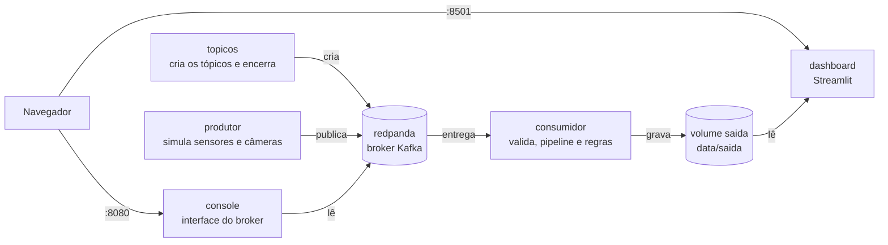

# Fase 4 | Containerização da solução

Este documento descreve o item 2 da Fase 4: a solução empacotada em contêineres
Docker e orquestrada por um `docker-compose.yml`. Um único comando sobe o broker
de streaming, o produtor, o consumidor e o painel.

## Arquitetura



O mesmo diagrama aparece no painel, na aba **🐳 Arquitetura e Docker**, junto
com o estado do broker.

## Serviços

| Serviço | Imagem | Porta | Função |
|---|---|---|---|
| `redpanda` | `redpandadata/redpanda` | 9092 | Broker Kafka. Dois endereços: `redpanda:29092` entre contêineres e `localhost:9092` para o seu computador |
| `console` | `redpandadata/console` | 8080 | Interface web para ver tópicos e mensagens |
| `topicos` | `agrovision:fase4` | | Tarefa única: cria os quatro tópicos e encerra |
| `produtor` | `agrovision:fase4` | | Simula sensores e câmeras e injeta um ataque a cada 8 rodadas |
| `consumidor` | `agrovision:fase4` | | Valida os eventos, grava na Bronze, roda pipeline e regras, publica alertas |
| `dashboard` | `agrovision:fase4` | 8501 | Painel Streamlit |

O painel, o produtor, o consumidor e a criação dos tópicos usam **a mesma imagem**
(`agrovision:fase4`), cada um com um comando diferente. Assim há um só Dockerfile
para manter e o código dos quatro nunca fica fora de sincronia.

## Como executar

Pré-requisito: Docker Desktop em execução.

```powershell
docker compose up --build        # primeira vez: constrói a imagem (alguns minutos)
```

Depois:

- Painel: http://localhost:8501, aba **📡 Streaming**
- Console do broker: http://localhost:8080, menu **Topics**

Comandos úteis:

```powershell
docker compose ps                    # estado dos serviços
docker compose logs -f consumidor    # acompanha a validação e os alertas
docker compose restart produtor      # repete a simulação
docker compose down                  # derruba, mantendo os dados
docker compose down -v               # derruba e apaga os dados
```

O produtor roda 40 rodadas (10 dias simulados) e encerra. Em seguida o painel
continua mostrando o resultado. Para outra execução, `docker compose restart produtor`.

## Decisões do Dockerfile

| Decisão | Motivo |
|---|---|
| Base `python:3.11-slim` | Mesma versão do CI, imagem enxuta |
| Dependências copiadas antes do código | Mexer no código não refaz a camada de instalação |
| `pip install -e .` | O projeto acha `models/` e `data/` a partir de `/app`, como fora do contêiner |
| Usuário `agro` sem privilégios | O processo não roda como root |
| `.dockerignore` sem `data/dataset`, testes e docs | A imagem leva só o que executa (o dataset de treino tem 200 imagens que o painel não usa) |
| Healthcheck só no `dashboard` | Produtor e consumidor não têm porta HTTP |

## Dados e configuração

- **Volume `saida`**: o consumidor grava nele e o painel lê. É o que permite os
  dois contêineres compartilharem Bronze, Silver, Gold, alertas e o estado do streaming.
- **`KAFKA_BROKER`**: endereço do broker, `redpanda:29092` dentro da rede do compose.
- **`AGROVISION_SEGREDO`**: chave das assinaturas dos eventos. O padrão serve só
  para a demonstração. Para trocar, defina a variável antes de subir:
  `$env:AGROVISION_SEGREDO = "outra-chave"; docker compose up`.
- **Ordem de partida**: `depends_on` com condições. Os tópicos só são criados
  quando o broker está saudável, e produtor e consumidor só iniciam depois dos tópicos.

## O que mostrar nos prints

1. `docker compose ps` com os serviços no ar.
2. Painel em http://localhost:8501, aba **📡 Streaming**, com as métricas, os
   alertas e a tabela de rejeições.
3. Aba **🐳 Arquitetura e Docker**, mostrando o broker acessível.
4. Console do broker em http://localhost:8080, tópico `agrovision.rejeitados`.
5. Docker Desktop, aba **Containers**, com o grupo `agrovision`.

## Resultado do teste

Executado com `docker compose up --build`:

- Os seis serviços sobem na ordem correta. `topicos` encerra com código 0.
- O broker responde como saudável e o painel responde `200` em `/_stcore/health`.
- O consumidor valida os eventos, roda o pipeline e emite alertas (R3, R4, R5, S1).
- Os ataques do produtor são rejeitados com motivo.
