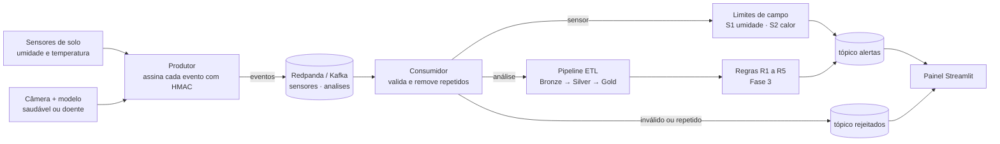

# Fase 4 | Pipeline de dados com streaming

Este documento descreve o item 1 da Fase 4: uma entrada contínua de dados
(leituras de sensores e folhas classificadas) que passa por um broker Kafka,
é validada e alimenta o pipeline e as regras de decisão das fases anteriores.

## Por que streaming agora

Na Fase 3 escolhemos micro-batch, porque nenhuma regra de folha exigia resposta
em minutos e a origem eram arquivos CSV
([fase3-ingestao.md](fase3-ingestao.md)). Registramos ali que Kafka seria a
escolha se houvesse um sensor emitindo eventos contínuos. A Fase 4 acrescenta
exatamente isso: sensores de solo e câmeras que emitem a cada poucos segundos.
Umidade crítica não pode esperar o fim do dia, então a leitura de sensor passa
a ser tratada por evento.

O micro-batch não foi descartado. As folhas classificadas continuam sendo
agrupadas em lotes de 6 análises antes de rodar o pipeline, porque o percentual
de doentes só faz sentido sobre uma amostra.

## Ferramenta escolhida: Redpanda

O Redpanda é um broker com a mesma API do Apache Kafka, em um único contêiner,
sem Zookeeper. O código usa a biblioteca `kafka-python`, então trocar por um
Kafka tradicional não exige mudar uma linha. Escolhemos o Redpanda porque sobe
em segundos e consome pouca memória em um notebook.

## Diagrama do pipeline



O mesmo diagrama é desenhado no painel, na aba **📡 Streaming**.

## Tópicos

Definidos em [streaming/topicos.json](../streaming/topicos.json).

| Tópico | Partições | Quem publica | Conteúdo |
|---|---|---|---|
| `agrovision.sensores` | 3 | produtor | Leitura de umidade do solo e temperatura |
| `agrovision.analises` | 3 | produtor | Folha classificada: categoria, confiança, data |
| `agrovision.alertas` | 1 | consumidor | Alertas dos sensores (S1, S2) e das regras (R1 a R5) |
| `agrovision.rejeitados` | 1 | consumidor | Evento recusado e o motivo |

A chave da mensagem é o dispositivo, então as leituras de um mesmo sensor ficam
em ordem dentro da partição. O offset confirmado pelo grupo `agrovision-consumidor`
faz o papel do checkpoint da ingestão em lote: ao reiniciar, nada é lido duas
vezes.

## Formato do evento

```json
{
  "id": "9f1c...",
  "tipo": "sensor",
  "dispositivo": "sensor-b",
  "talhao": "Talhão B",
  "ts": 1763600000.12,
  "carga": {"umidade_solo": 27.1, "temperatura": 28.4},
  "assinatura": "c4e1..."
}
```

Para `tipo = "analise"`, a `carga` traz `nome_imagem`, `categoria`, `acuracia` e
`data`, as mesmas colunas da camada Bronze.

## Segurança do pipeline

Aplica os riscos vistos no capítulo de segurança em IoT: dispositivos sem
controle, replay, clonagem de nó e adulteração de configuração.

| Controle | Ameaça que barra | Onde |
|---|---|---|
| Assinatura HMAC-SHA256 de cada evento | Evento adulterado no caminho ou forjado sem a chave | `eventos.validar` |
| Lista de dispositivos autorizados | Nó clonado ou dispositivo desconhecido | `eventos.validar` |
| Janela de 5 minutos no timestamp | Replay de evento capturado há muito tempo | `eventos.validar` |
| Memória dos ids já processados | Replay de evento recente | `Consumidor.tratar` |
| Faixa física dos valores | Sensor com defeito ou valor forjado | `eventos.validar` |
| Segredo vindo do ambiente (`AGROVISION_SEGREDO`) | Chave fixa no código | `eventos.segredo` |
| Rejeitados em tópico próprio, com motivo | Falta de rastreabilidade | `Consumidor._rejeitar` |

Limites conhecidos: o segredo é compartilhado entre os dispositivos. Em
produção, cada dispositivo teria a sua chave e a comunicação com o broker iria
em TLS com autenticação.

O produtor tem um modo de ataque (`--ataque-a-cada N`) que injeta os quatro
casos para a demonstração: assinatura quebrada, replay, dispositivo clonado e
valor fora da faixa. O consumidor deve rejeitar todos.

## Regras sobre sensores

| Regra | Condição | Nível | Ação |
|---|---|---|---|
| S1 | Umidade do solo abaixo de 30% | Crítico | Irrigar |
| S2 | Temperatura acima de 35 °C | Crítico | Avaliar estresse térmico |

O alerta sai uma vez por desvio. Só repete depois que a leitura voltar ao normal.
As regras R1 a R5 de folhas doentes continuam as da Fase 3.

## Como executar

Para rodar o broker e os processos Python no seu computador:

```powershell
docker compose -f streaming/broker.yml up -d
.\.venv\Scripts\python.exe -m agrovision.streaming.transporte           # cria os tópicos
.\.venv\Scripts\python.exe -m agrovision.streaming.consumidor --demo    # terminal A
.\.venv\Scripts\python.exe -m agrovision.streaming.produtor --ticks 32 --intervalo 1 --ataque-a-cada 8   # terminal B
.\.venv\Scripts\python.exe -m streamlit run src/agrovision/app.py       # aba Streaming
```

Console dos tópicos: http://localhost:8080.

Sem Docker, o botão **▶ Simular** da aba Streaming (ou
`python -m agrovision.streaming.demo`) roda produtor e consumidor no mesmo
processo, com filas em memória, e preenche a aba com o resultado.

## Estrutura do código

| Arquivo | Função |
|---|---|
| `src/agrovision/streaming/eventos.py` | Formato, assinatura e validação dos eventos |
| `src/agrovision/streaming/transporte.py` | Kafka (Redpanda) e filas em memória, com a mesma interface |
| `src/agrovision/streaming/produtor.py` | Simula sensores e câmeras, com modo de ataque |
| `src/agrovision/streaming/consumidor.py` | Valida, grava na Bronze, aplica regras e publica alertas |
| `src/agrovision/streaming/demo.py` | Simulação completa sem broker |
| `streaming/topicos.json` | Configuração dos tópicos |
| `streaming/broker.yml` | Só o broker, para rodar os processos Python fora de contêiner |
| `tests/test_streaming.py` | Segurança dos eventos, consumidor e fluxo completo |

## Resultado esperado da demonstração

Com `--ticks 32 --ataque-a-cada 8` (8 dias simulados):

- 288 eventos aceitos e 4 rejeitados (assinatura, replay, dispositivo clonado e valor).
- O Talhão B adoece dia a dia e chega à regra R5, prioridade máxima.
- O Talhão B perde umidade e dispara o alerta S1 de irrigação.
- Os talhões A e C ficam estáveis. Com amostras de poucas folhas por dia, o
  Talhão C pode alertar uma vez por variação da amostra.
